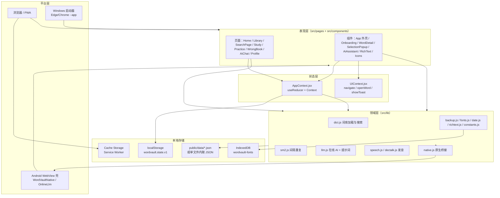
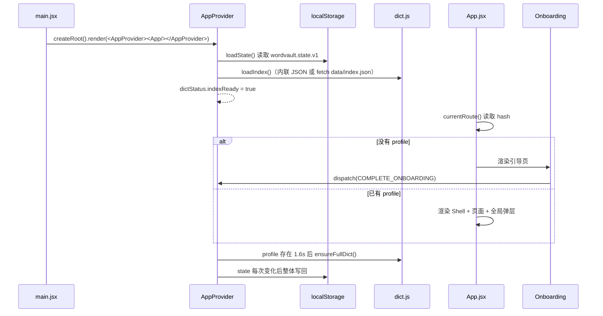
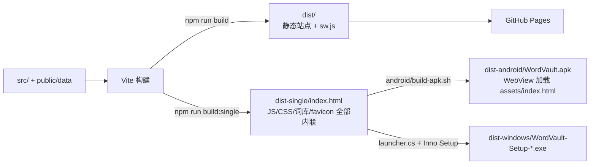

# 01 整体架构

## 1. 一句话概括

WordVault 是一个**纯前端、本地优先**的单词学习 SPA：React 负责界面与交互，`AppContext` 是唯一数据源，`src/lib/*` 承担词库、复习算法、AI、语音等能力，`public/data/*` 提供离线词库；同一份构建产物可被浏览器、Android WebView、Windows 启动器直接加载。

## 2. 分层视图



### 2.1 各层职责

| 层 | 位置 | 职责 | 不负责 |
| --- | --- | --- | --- |
| 表现层 | `src/pages`、`src/components` | 渲染、交互、局部 UI 状态、调用 dispatch / lib | 直接读写 localStorage、直接发网络请求 |
| 状态层 | `src/AppContext.jsx`、`src/UIContext.jsx` | 全局状态、持久化、派生统计、词库加载状态、主题与字体副作用 | 具体页面布局 |
| 领域层 | `src/lib` | 词库解析与搜索、SM-2、AI 流式请求、语音、备份、字体、日期、富文本 | React 状态 |
| 数据层 | `public/data`、浏览器存储 | 静态词库、用户数据、字体文件、离线缓存 | 业务逻辑 |
| 平台层 | `android/`、`windows/`、`serverless/`、`public/sw.js` | 原生能力桥接、打包分发、CORS 代理、离线缓存 | 业务规则 |

## 3. 启动与运行时数据流



关键点：

1. **先加载索引，后加载完整词库**。索引约 2.3 MB，用于列表、搜索、统计；完整词库约 15.3 MB，进入学习/练习/词条详情时才需要。加载逻辑见 [05 核心库 · dict.js](./05-lib.md#2-dictjs词库加载与搜索)。
2. **状态整体持久化**。`AppProvider` 的 `useEffect([state])` 把整个 state JSON 写入 localStorage；没有细粒度存储层。
3. **词库来源可切换**。单文件构建把两段 JSON 写入 `<script type="application/json">`，`dict.js` 优先读取内联节点，否则 `fetch`。
4. **UI 与业务分离**。页面通过 `useApp()` 拿 `state/dispatch/stats/dict`，通过 `useUI()` 拿导航与全局弹层能力。
5. **入口只做两件事**。`main.jsx` 用 `StrictMode` 挂载应用，并在生产构建（非单文件）时注册 `sw.js`；业务副作用全部在 Provider 与组件内。

## 4. 路由机制

没有引入 React Router，`src/App.jsx` 用 `window.location.hash` 手写路由：

| hash | 页面 | 是否 focus 模式（隐藏顶栏与底部导航） |
| --- | --- | --- |
| `#/home` | `pages/Home.jsx` | 否 |
| `#/library` | `pages/Library.jsx` | 否 |
| `#/search` | `pages/SearchPage.jsx` | 否 |
| `#/ai` | `pages/AiChat.jsx` | 否 |
| `#/profile` | `pages/Profile.jsx` | 否 |
| `#/study` | `pages/Study.jsx` | 是 |
| `#/practice/:mode` | `pages/Practice.jsx` | 是 |
| `#/wrong` | `pages/WrongBook.jsx` | 是 |
| `#/theme` | 特殊路由：切换深浅色后跳回 | — |

- `currentRoute()` 去掉 `#/` 前缀，空值回退 `home`。
- `navigate(path)` 设置 hash；若目标与当前相同则平滑滚动到顶部。
- `hashchange` 时更新路由并滚动到顶部。
- `base` 只取第一段，因此 `practice/choice` 会渲染 Practice 并传入 `mode="choice"`。
- `#/theme` 不是真实页面：`Shell` 检测到该路由后 dispatch `UPDATE_SETTINGS` 切换主题，再跳回原页面。这是顶栏月亮/太阳按钮的实现方式。

## 5. 全局 UI 结构

```text
App
├── Onboarding                     profile 为空时独占渲染
└── UIContext.Provider
    ├── Shell
    │   ├── AppHeader              focus 模式不渲染
    │   ├── 当前页面
    │   ├── BottomNav              focus 模式不渲染
    │   └── ReminderWatcher        每日提醒调度（原生 / 浏览器两套）
    ├── WordDetail                 全局词条详情弹层（detailWord 非空时）
    ├── SelectionPopup             页面选中英文后的取词弹层
    └── Toast                      顶部短提示
```

`UIContext` 只暴露三个能力：`navigate(path)`、`openWord(word)`、`showToast(message)`。任意页面或组件都可以打开词条详情，无需层层传 props。

## 6. 跨平台形态

同一份前端代码通过不同壳运行：



| 形态 | 加载方式 | 额外能力 | 限制 |
| --- | --- | --- | --- |
| 浏览器 / PWA | Vite 静态站点，注册 `sw.js` | Service Worker 缓存、浏览器通知、`<a download>` 导出 | 需要网络首次加载词库（之后缓存） |
| 单文件 HTML | `file://` 直接打开 `dist-single/index.html` | 完全离线、无 SW | 不注册 Service Worker；`<a download>` 与 Notification 受限 |
| Android APK | `file:///android_asset/index.html` | 原生导出、通知、每日 AlarmManager 提醒、Kilo AI 原生 HTTP 桥 | 单文件 WebView 环境 |
| Windows 安装包 | 启动器调用 Edge/Chrome `--app` 打开本地 HTML | 独立窗口、桌面快捷方式 | 依赖本机 Edge/Chrome，找不到则退回默认浏览器 |

## 7. 模块依赖关系

### 7.1 前端模块依赖

```text
src/main.jsx
└── AppContext.jsx
    ├── lib/constants.js
    ├── lib/date.js
    ├── lib/sm2.js
    ├── lib/dict.js
    └── lib/fonts.js
└── App.jsx
    ├── AppContext / UIContext
    ├── components/Icons / Onboarding / WordDetail / SelectionPopup
    ├── pages/*
    ├── lib/date.js
    └── lib/native.js

pages/*
├── AppContext / UIContext
├── lib/constants.js
├── lib/dict.js
├── lib/sm2.js
├── lib/speech.js
├── lib/llm.js
├── lib/backup.js
├── lib/fonts.js
├── lib/native.js
└── components/*

components/*
├── AppContext / UIContext
├── lib/constants.js
├── lib/dict.js
├── lib/sm2.js
├── lib/speech.js
├── lib/llm.js
├── lib/richtext.js
└── components/Icons.jsx
```

### 7.2 依赖方向规则

- `lib` 不依赖 React（`dict.js` 里的 `useDictionaryPrefetch` 是唯一例外，且当前页面未使用）。
- `pages` 与 `components` 不互相深度依赖，共享 UI 通过 `UIContext`。
- `AppContext` 是唯一能直接读写 localStorage 的模块（`fonts.js` 读写 IndexedDB，`native.js` 只转发桥接）。
- Android / Windows / Serverless 与前端只通过约定接口通信：`window.WordVaultNative`、`window.OnlineLlm`、`window.WordVaultOnline`、HTTP。

## 8. 关键设计决策

| 决策 | 原因 | 代价 |
| --- | --- | --- |
| 词库拆成 index + dictionary 两份 | 首屏只加载 2.3 MB 索引，15.3 MB 完整词库延迟加载 | 两套数据结构需要保持一致，维护脚本要同时更新 |
| 单文件构建把词库内联进 HTML | `file://` 下 `fetch` 本地 JSON 受限，单文件最稳 | 产物约 18–20 MB，无法利用浏览器分块缓存 |
| SM-2 而非自研算法 | 成熟、可解释、实现简单 | 参数固定，缺少个性化调优 |
| 每日复习上限 | 避免积压时一次涌入几百个到期词 | 到期词需要顺延，用户可能看到「待复习」大于今日可复习 |
| AI 提供方可插拔 | 支持 llm7 / DeepSeek / Kilo / 自定义 OpenAI 兼容服务 | API Key 存在 localStorage，需要用户自行保管备份 |
| 语音双通道 | Web Speech 在部分 WebView / 系统上不可用 | 内嵌 DECtalk WASM 增加包体与初始化开销 |
| 无路由库、无状态库 | 依赖少、包体小、行为可预测 | 路由能力有限，复杂页面状态需自行管理 |

## 9. 已知边界与注意点

- **实验性代码**：`android/src/com/wordvault/app/LlmBridge.java`、`LlmEngine.java`、`android/jni/llm_jni.cpp` 是本地 GGUF 推理实验，当前前端未接入（`src` 中没有 `WordVaultLlm` / `LlmNative` 引用），默认构建不包含原生库。
- **遗留文件**：`src/App.css`、`src/assets/hero.png`、`react.svg`、`vite.svg`、`public/icons.svg` 当前未被引用；`src/index.css` 只做基础重置，视觉样式集中在 `src/styles.css`。
- **数据一致性**：`src/lib/constants.js` 的 `BOOKS` 必须与 `public/data/dictionary.json` 的 `books` 保持一致，否则词书筛选会失效。
- **存储容量**：localStorage 约 5 MB，学习记录很大时写入可能失败；`AppProvider` 会静默忽略写入异常，会话内仍可用。
- **安全边界**：AI 返回内容经 `marked` + `DOMPurify` 清洗，KaTeX 在清洗之后注入；词库内容被视为可信静态数据。

## 10. 延伸阅读

- 状态字段与 reducer 细节：[02 状态管理与数据模型](./02-state-and-data.md)
- 页面职责与交互：[03 页面模块](./03-pages.md)
- 原生桥接与打包：[06 平台层与外围](./06-platforms.md)
