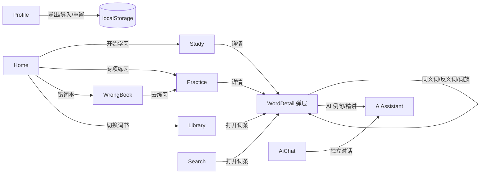

# 03 页面模块

所有页面位于 `src/pages/`，都是函数组件，通过 props 拿到 `navigate` / `openWord`，通过 `useApp()` / `useUI()` 拿全局状态。页面本身只保留**局部交互状态**（输入框、当前题号、弹层开关等），业务数据全部来自 `AppContext`。

## 1. 路由与页面映射

| 路由 | 组件 | 文件 | 模式 |
| --- | --- | --- | --- |
| `home` | `Home` | `src/pages/Home.jsx` | 标准（顶栏 + 底部导航） |
| `library` | `Library` | `src/pages/Library.jsx` | 标准 |
| `search` | `SearchPage` | `src/pages/SearchPage.jsx` | 标准 |
| `ai` | `AiChat` | `src/pages/AiChat.jsx` | 标准 |
| `profile` | `Profile` | `src/pages/Profile.jsx` | 标准 |
| `study` | `Study` | `src/pages/Study.jsx` | focus（隐藏顶栏与导航） |
| `practice/{mode}` | `Practice` | `src/pages/Practice.jsx` | focus |
| `wrong` | `WrongBook` | `src/pages/WrongBook.jsx` | focus |

页面切换时 `Shell` 用 `key={route}` 包一层 `page-transition`，触发入场动画。

## 2. Home（今日）

**定位**：学习仪表盘与今日任务入口。

**关键数据**：

```js
const { state, stats, dict } = useApp()
const { currentBook, dailyNew, dailyReview, reviewRemaining, dueCount, newRemaining, todayActivity } = stats
```

**派生逻辑**：

| 变量 | 计算 |
| --- | --- |
| `newDone` | `min(todayActivity.newWords, dailyNew)` |
| `dueToday` | 受复习上限约束后的到期数：`dailyReview > 0 ? min(dueCount, reviewRemaining) : dueCount` |
| `progress` | `(newDone + reviewDone) / max(1, dailyNew + reviewDone + dueToday)`，上限 100 |
| `allDone` | `newRemaining <= 0 && dueToday <= 0` |
| `reviewLimitHit` | 达到复习上限但仍有到期词 |
| `bookStats` | 当前词书索引词数、状态为 `known` 的词数（`useMemo`） |
| `streak` | `computeStreak(state.activity)` |
| `accuracy` | `correct / total`，无作答时为 0 |

**子组件 `WeeklyChart`**：最近 7 天（`weekDays()`）的柱状图，可在「新学词数 / 复习词数 / 学习时长」三种指标间切换。柱高按当日最大值归一化，无数据时保留 2% 基线。

**页面区块**：

1. 问候语 + 当前水平 / 词书。
2. 今日任务卡：进度条、新学/复习/待复习计数、主按钮（文案随任务状态变化）。
3. 统计条：已掌握、错词、当前词书进度、今日时长。
4. 周概览图表。
5. 专项练习入口（4 个模式卡片）。
6. 当前词书进度 + 错词本入口。

**跳转**：`study`、`practice/{mode}`、`library`、`wrong`。

## 3. Library（词库）

**定位**：切换词书、浏览当前词书全部词条。

**局部状态**：`query`、`filter`（`all/new/learning/known/favorite/wrong`）、`limit`（默认 60，每次 +80）。

**关键逻辑**：

| 变量 | 说明 |
| --- | --- |
| `bookWords` | 索引中 `b` 包含当前 `bookId` 的词 |
| `bookCounts` | 当前词书内 `known` / `learning` / `favorite` / `wrong` 计数；`learning` 实际包含所有非 known 记录 |
| `filtered` | 先按关键词匹配单词或中文释义，再按筛选条件过滤 |
| `visible` | `filtered.slice(0, limit)` |
| `progress` | `known / bookWords.length` |

**交互**：

- 顶部词书 tab：dispatch `UPDATE_SETTINGS { bookId }`，同时重置搜索、筛选和分页。
- 行点击：`openWord(w.w)` 打开全局词条详情。
- 筛选：`new` 表示无记录；`learning` 表示有记录且非 known。
- 未加载索引时显示 spinner；结果为空显示空态。

## 4. SearchPage（查词）

**定位**：本地离线查词 + 搜索历史 + 选词演示。

**局部状态**：`query`；结果用 `useMemo` 依赖 `query` 与 `dict.indexReady` 重新计算。

**关键函数**：

| 函数 | 行为 |
| --- | --- |
| `searchWords(query, 40)` | 见 [05 · dict.js](./05-lib.md#2-dictjs词库加载与搜索) |
| `suggestionsFor(bookId, 8)` | 当前词书等距抽样推荐 |
| `commit(term)` | 非空时 dispatch `ADD_SEARCH` |
| `open(word)` | 记录搜索词并 `openWord(word)` |

**展示逻辑**：

- 有输入：结果列表，单词和中文释义命中部分用 `<mark>` 高亮（`Highlight` 组件只高亮第一处）。
- 无输入：搜索历史（最多 15 条，可清空）、当前词书推荐卡片、可选中英文的演示段落。
- 空结果时提示「当前词库不包含所有英语专有名词」。

## 5. Study（学习 / 复习）

**定位**：SM-2 闪卡学习主流程，是复习调度的主要入口。

**启动流程**：

```text
进入页面
→ 若 dict.fullReady 为 false：调用 ensureFullDict() 并显示加载页
→ 词库就绪且队列为空：buildQueue(state, settings.bookId)
→ 队列为空：直接 finished
→ 否则记录 startRef 时间，开始第一张卡
```

**队列构建**（`buildQueue`）：

1. 所有 `due <= now` 的记录按到期时间升序。
2. 受 `dailyReview` 与今日已复习数约束，得到 `dueQueue`。
3. 新词：当前词书、无学习记录、按 `r` 升序（词频优先），取 `dailyNew - 今日新学` 个。
4. 合并后过滤掉完整词库中不存在的词。

**卡片状态机**：

| 状态 | 说明 |
| --- | --- |
| 正面 | 单词、英美音标、发音按钮、来源词书 |
| 翻面 | `flipped = true`，显示释义、首条例句、词根、近义词、下次复习时间 |
| 评分 | 忘记(1) / 模糊(3) / 记得(4) / 熟练(5) |
| 反馈 | 280ms 的高亮动画后自动进入下一张 |
| 完成 | `finished = true`，展示本次新学、复习、正确率与今日累计时长 |

**评分副作用**：

```js
dispatch({ type: 'ANSWER_WORD', word, quality, isNew, mode: 'flashcard' })
```

- 本地 `results` 同步累加，用于结束页统计。
- 答错（quality < 3）会进入错词本，并安排 10 分钟后重试。

**键盘快捷键**：

| 按键 | 行为 |
| --- | --- |
| `Space` | 翻面 |
| `1` / `2` / `3` / `4` | 分别评分 忘记 / 模糊 / 记得 / 熟练（仅翻面且无反馈时生效） |

输入框聚焦时快捷键不生效。

**计时**：首次构建队列时记录 `startRef`；退出、完成或组件卸载时，若本次时长 ≥ 0.05 分钟则 dispatch `ADD_TIME`，并用 `recordedRef` 防止重复记录。

**自动发音**：`settings.autoSpeak` 开启时，新卡片正面出现 260ms 后朗读；翻面后不朗读。

## 6. Practice（专项练习）

**定位**：4 种本地题型 + AI 出题，每组 10 题，结果写回 SM-2。

**题型**（`PRACTICE_MODES`）：

| mode | 名称 | 题干 | 选项 / 输入 | 额外条件 |
| --- | --- | --- | --- | --- |
| `choice` | 看英选中 | 英文单词 + 音标 | 4 个中文释义 | 无 |
| `listening` | 听音辨词 | 只播放发音 | 4 个英文单词 | 进入题目 280ms 后自动朗读 |
| `spelling` | 拼写测试 | 中文释义 + 音标 | 文本输入 | 输入框自动聚焦 |
| `cloze` | 选词填空 | 例句挖空 | 4 个英文单词 | 例句必须包含该词 |

**出题算法 `buildQuestions(mode, bookId)`**：

1. 取当前词书全部索引词，映射到完整词条并过滤空值。
2. 过滤掉无中文/英文释义的词；cloze 模式额外要求例句包含该词（单词边界正则）。
3. 随机洗牌后取 10 个。
4. 每个词生成 3 个干扰项：从可用词池中排除同词、同释义后随机抽取。
5. 选项再次洗牌。

> 若可用词不足 4 个，`start()` 会直接返回，不进入练习（界面无显式提示）。

**答题流程**：

- 选择选项 / 提交拼写 → `submitAnswer(isCorrect)` → dispatch `ANSWER_WORD`（答对 4，答错 2，`isNew: !state.wordStates[word]`）。
- 答错自动进入错词本。
- 点击「下一题」；最后一题后展示总结（答对数、答错数、正确率）。
- 侧栏可随时切换题型，切换会重置整组练习并更新 hash。

**AI 出题**：

1. 从当前词书随机抽一个完整词条。
2. `activeAiProvider(settings)` 取当前提供方。
3. `buildQuizMessages(entry, mode)` → `generate({ maxTokens: 260, temperature: 0.35 })`。
4. `parseQuiz(text)` 解析 `{question, options, answer, explain}`。
5. cloze 之外统一按单选处理；选项为空时退化为拼写输入。
6. 作答后同样 dispatch `ANSWER_WORD { mode: 'ai' }`。

AI 调用失败只显示错误文案，不影响本地练习。

## 7. WrongBook（错词本）

**定位**：集中处理 `wrongFlag === true` 的单词。

**数据**：

```js
records = Object.values(state.wordStates)
  .filter(r => r.wrongFlag)
  .sort((a, b) => (b.lastReviewedAt || 0) - (a.lastReviewedAt || 0))
```

**筛选**：全部 / `unknown`（完全陌生）/ `familiar`（不熟悉）。

**操作**：

| 操作 | dispatch | 结果 |
| --- | --- | --- |
| 点击词条 | `openWord(word)` | 打开词条详情 |
| 仍不熟 | `SET_STATUS { status: 'familiar' }` | 保留在错词本，`due = now` |
| 已掌握 | `SET_STATUS { status: 'known' }` | `wrongFlag = false`，移出错词本，30 天后复习 |
| 去练习 | 跳转 `practice/choice` | — |

每条记录展示：单词、音标、所属词书、释义、状态、答错次数、下次复习时间。

## 8. AiChat（AI 对话）

**定位**：自由问答式英语学习助手，对话持久化在本地。

**可用性检查**：

```js
const supported = onlineSupported()   // 原生 OnlineLlm 桥接或浏览器 fetch
```

不支持时显示空态页。

**发送流程**：

1. 校验非空、非 busy；DeepSeek 提供方且无 Key 时提示先配置。
2. 先把「用户消息 + 空的 assistant 占位」放入 `messages`，进入流式状态。
3. `buildChatMessages(history, question)` 只带最近 6 轮历史，并限制回答 150 字。
4. `generate({ maxTokens: 400, temperature: 0.7, onToken })` 每收到增量就更新最后一条 assistant 消息。
5. 成功后 dispatch `AI_SET_CHAT` 持久化；失败则回滚到最后一条用户消息并显示错误。

**其他行为**：

- 流式生成期间最后一条消息用 `StreamingText` 逐字渲染；完成后改用 `RichMarkdown`。
- 用户手动上滚超过 80px 时停止自动贴底。
- 「停止」调用 `cancelGeneration()`：原生桥接 cancel 或 AbortController。
- 「清空对话」二次确认后 dispatch `AI_CLEAR_CHAT`。
- 预置 4 条示例问题（affect/effect、abandon 记忆法、take on、adapt/adopt）。

## 9. Profile（我的）

**定位**：画像、提醒、外观、AI、本地数据的统一设置中心。

### 9.1 结构

- 顶部头像 + 昵称（可编辑，最多 16 字）+ 身份标签 + 4 项统计。
- 5 个 tab：学习画像 / 提醒与声音 / 外观字体 / AI 引擎 / 本地数据。
- 点击设置行进入二级详情面板（`detail` 状态），`Esc` 返回；切换 tab 会关闭详情。

### 9.2 各 Tab 能力

| Tab | 设置项 | 写入 |
| --- | --- | --- |
| 学习画像 | 身份标签（多选）、学习目标、英语水平、每日新词、每日复习上限、昵称 | `UPDATE_PROFILE`；目标同时 `UPDATE_SETTINGS { bookId }` |
| 提醒与声音 | 每日提醒时间、系统/浏览器通知开关、发音偏好、自动朗读 | `UPDATE_PROFILE` / `UPDATE_SETTINGS` |
| 外观字体 | 主题（浅色/深色/跟随系统）、界面字体（系统/衬线/等宽/自定义上传） | `UPDATE_SETTINGS` |
| AI 引擎 | 选择提供方、编辑名称/地址/模型/Key、新增或删除自定义提供方 | `UPDATE_SETTINGS { aiProviders, aiProviderId }` |
| 本地数据 | 导出备份、导入恢复、清空学习记录、恢复初始状态、关于 | `IMPORT_STATE` / `RESET_PROGRESS` / `RESET_ALL` |

### 9.3 关键函数

| 函数 | 说明 |
| --- | --- |
| `saveName()` | 昵称判空后 `UPDATE_PROFILE` |
| `toggleIdentity(item)` | 多选标签增删 |
| `chooseGoal(item)` | 更新目标并把默认词书切到目标对应词书 |
| `chooseLevel(item)` | 只更新水平，不自动改每日新词（引导页会自动带出） |
| `requestPermission()` | 原生走 `requestNotificationPermission`，浏览器走 `Notification.requestPermission` |
| `toggleNotify()` | 未授权时先申请；已拒绝/不支持则提示 |
| `handleFontUpload(file)` | 校验扩展名与 ≤ 8 MB，写入 IndexedDB 并切换为 custom |
| `removeCustomFont()` | 删除 IndexedDB 记录并回退系统字体 |
| `exportData()` | `downloadBackup(state)`，原生返回 `native`，浏览器返回 `web` |
| `importData(file)` | 读取文本 → `parseBackup` → 二次确认 → `IMPORT_STATE` |
| `resetProgress()` | 二次确认后清空进度，保留画像与设置 |
| `resetAll()` | 二次确认后恢复默认 state 并跳回首页（触发引导） |

### 9.4 通知权限刷新

原生环境下监听 `wordvault:permission-changed` 事件与 `visibilitychange`，回到前台时重新读取 `notificationStatus()`，保证用户在系统设置里改过权限后 UI 能同步。

### 9.5 AI 提供方编辑

- `providers` 优先取 `settings.aiProviders`，为空时回退内置 `AI_PROVIDERS`。
- `updateProvider(patch)` 按当前 provider id 替换数组项后整体写回。
- `addProvider()` 生成 `custom-<base36 时间>` id，并立即设为当前提供方。
- `removeProvider()` 只允许删除非预设项；删除后若当前项被删，回退到剩余第一项。
- API Key 输入框为 `password` 类型，仍以明文存于 localStorage（本地应用权衡）。

## 10. 页面间协作



共同约定：

- 任何页面都不直接读写 `localStorage`，统一走 dispatch。
- 任何页面都通过 `openWord` 打开词条详情，保证侧栏 AI 与掌握度操作一致。
- 所有 toast 统一走 `useUI().showToast`，2.4 秒后自动消失。
