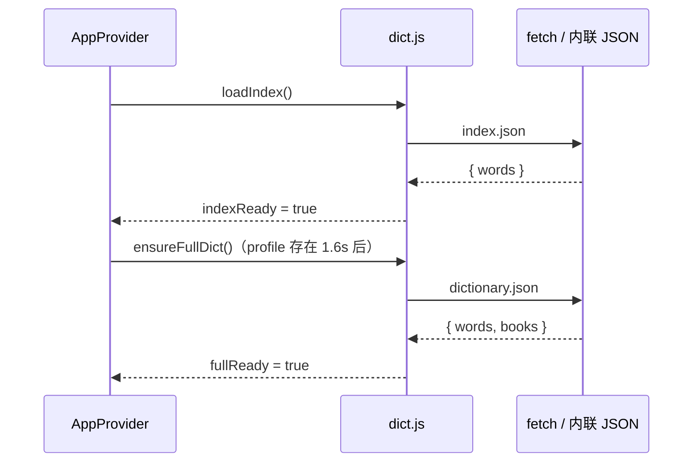
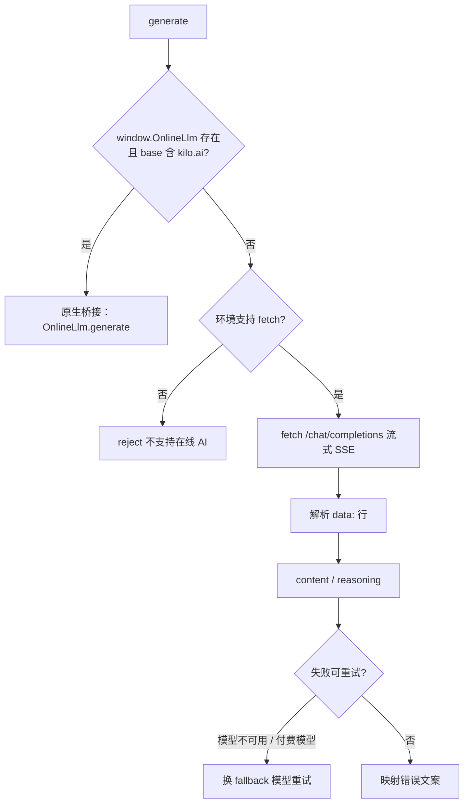
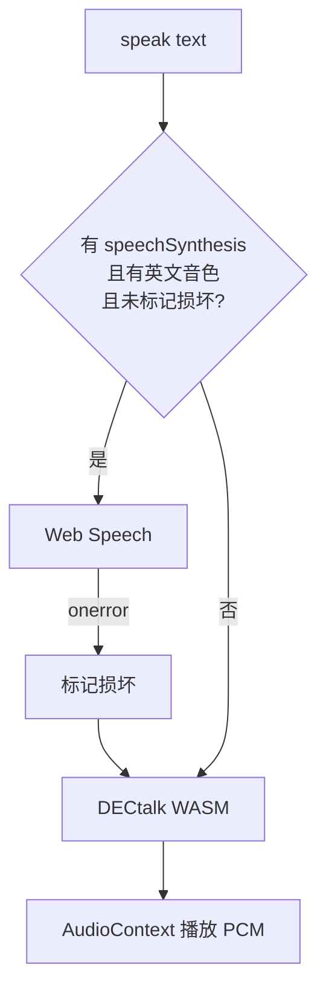

# 05 核心库（src/lib）

`src/lib` 是与 React 解耦的能力层。除 `dict.js` 的 `useDictionaryPrefetch` 外，所有模块都是普通函数/常量，可在浏览器、测试或脚本中直接调用。

## 1. 模块总览

| 模块 | 作用 | 主要导出 |
| --- | --- | --- |
| `dict.js` | 词库加载、查询、搜索 | `loadIndex`、`loadFullDictionary`、`lookupBasic`、`lookupFull`、`searchWords`、`suggestionsFor` |
| `sm2.js` | SM-2 间隔重复 | `QUALITY`、`schedule`、`intervalPreview`、`nextReviewLabel` |
| `llm.js` | 在线 AI 请求与提示词 | `generate`、`cancelGeneration`、`onlineSupported`、`onlineNative`、`build*Messages`、`parseQuiz` |
| `speech.js` | 发音（Web Speech + DECtalk） | `speak`、`stopSpeech` |
| `dectalk.js` | 内嵌 WASM 的 TTS 引擎 | 默认导出 DECtalk 模块工厂 |
| `native.js` | Android 原生桥接 | `isNativeApp`、`scheduleDailyReminder`、`exportBackupNative` 等 |
| `backup.js` | 备份导出/解析 | `downloadBackup`、`parseBackup` |
| `fonts.js` | 自定义字体 IndexedDB | `saveCustomFont`、`getCustomFont`、`deleteCustomFont`、`applyCustomFont`、`setAppFont` |
| `date.js` | 日期与连续打卡 | `dateKey`、`todayKey`、`weekDays`、`computeStreak`、`activeDays`、`formatMinutes` |
| `richtext.js` | Markdown + KaTeX 安全渲染 | `renderRich` |
| `constants.js` | 词书、目标、水平、AI 提供方等静态配置 | `BOOKS`、`GOALS`、`LEVELS`、`PRACTICE_MODES`、`AI_PROVIDERS`、`activeAiProvider` |

## 2. dict.js（词库加载与搜索）

### 2.1 内部状态

```js
let indexPromise = null   // 索引加载 Promise，保证只加载一次
let dictPromise = null    // 完整词库加载 Promise
let indexWords = []       // 索引数组
let indexMap = new Map()  // 归一化单词 -> 索引项
let dictMap = new Map()   // 归一化单词 -> 完整词条
```

### 2.2 数据来源

```js
// 单文件构建：优先读取内联 JSON
document.getElementById('wordvault-index')
document.getElementById('wordvault-dictionary')

// 否则 fetch
`${import.meta.env.BASE_URL}data/index.json`
`${import.meta.env.BASE_URL}data/dictionary.json`
```

`fetch` 使用 `{ cache: 'force-cache' }`，优先命中 HTTP 缓存。

### 2.3 函数

| 函数 | 签名 | 说明 |
| --- | --- | --- |
| `loadIndex()` | `() => Promise<{words, map}>` | 幂等加载索引；失败时清空 `indexPromise` 允许重试 |
| `loadFullDictionary()` | `() => Promise<{words, map, meta}>` | 幂等加载完整词库；失败可重试 |
| `getIndexWords()` | `() => Array` | 返回已加载的索引数组（未加载时为空数组） |
| `getIndexMap()` / `getDictMap()` | `() => Map` | 返回内部 Map |
| `lookupBasic(word)` | `(word) => item \| null` | 索引查询 |
| `lookupFull(word)` | `(word) => entry \| null` | 完整词条查询 |
| `normalize(word)` | 内部 | `trim → lower → ’ 替换为 '` |
| `scoreWord(word, query)` | `(string, string) => number` | 英文匹配打分 |
| `searchWords(query, limit = 40)` | `=> item[]` | 中英文搜索 |
| `suggestionsFor(bookId, count = 8)` | `=> item[]` | 当前词书等距抽样 |
| `useDictionaryPrefetch(enabled)` | React hook | 延迟 1.8s 预取完整词库（当前页面未使用） |

### 2.4 搜索打分

| 匹配方式 | 分数 |
| --- | --- |
| 完全相等 | 1000 |
| 前缀 | `850 - 长度差` |
| 包含 | `700 - 位置 * 4 - 长度差` |
| 子序列 | `max(1, 220 - 间隔 * 8 - 长度差 * 2)` |
| 中文释义包含（中文查询） | 前缀 620 / 包含 480 |
| 中文释义包含（英文查询） | 350 |

结果按分数降序、单词长度升序排序，取前 `limit` 条。中文查询同时保留英文匹配分数，因此输入「放弃」可以命中 `abandon`。

### 2.5 加载时序



## 3. sm2.js（间隔重复）

### 3.1 导出

| 导出 | 类型 | 说明 |
| --- | --- | --- |
| `QUALITY` | 常量 | `{ again: 1, hard: 3, good: 4, easy: 5 }` |
| `schedule(record, quality, now)` | 函数 | 计算下一次 `ease / interval / reps / due / lastQuality` |
| `intervalPreview(record, quality)` | 函数 | 返回「10 分钟 / 1 天 / 2 个月」等预览 |
| `nextReviewLabel(record)` | 函数 | 返回「尚未安排 / 现在复习 / X 后复习」 |

### 3.2 公式

```js
ease = round2(max(1.3, ease + (0.1 - (5 - q) * (0.08 + (5 - q) * 0.02))))

if (q < 3) {
  reps = 0; interval = 0; due = now + 10 分钟
} else {
  reps += 1
  interval = reps === 1 ? 1 : reps === 2 ? 6 : max(1, round(interval * ease))
  due = now + interval 天
}
```

`humanize(ms)` 的输出规则：

| 区间 | 文案 |
| --- | --- |
| < 1 小时 | `N 分钟` |
| < 30 天 | `N 天` |
| < 365 天 | `N 个月` |
| ≥ 365 天 | `N 年` |

## 4. llm.js（在线 AI）

### 4.1 常量与环境

| 名称 | 值 | 说明 |
| --- | --- | --- |
| `AI_DEFAULT_BASE` | `https://api.llm7.io/v1` | 默认服务地址 |
| `ONLINE_DEFAULT_MODEL` | `codestral-latest` | 默认模型 |
| `FALLBACK_MODEL` | `mistral-Nemo-Instruct-2407` | llm7 模型不可用时的后备 |
| `KILO_HOST` | `ai-gateway.kilo.ai` | 触发原生桥接的域名 |
| `KILO_FALLBACK_MODEL` | `nvidia/nemotron-3.5-super-vl:free` | Kilo 付费模型报错时的后备 |

模块加载时会：

```js
const onlineBridge = window.OnlineLlm || null
window.WordVaultOnline = {
  onToken(id, text) { ... },
  onDone(id, ok, message) { ... },
}
```

后者供 Android 原生层回调。

### 4.2 请求路径选择



### 4.3 `generate(options)`

| 参数 | 默认 | 说明 |
| --- | --- | --- |
| `messages` | 必填 | `[{role, content}]` |
| `maxTokens` | 512 | 实际发送 `max(maxTokens, 768)` |
| `temperature` | 0.6 | — |
| `onToken(delta, full)` | — | 每段增量回调；reasoning 也作为增量 |
| `model` | `codestral-latest` | — |
| `apiKey` | `''` | 非空时加 `Authorization: Bearer` |
| `base` | `''` | 空则用默认地址；自动补 `/chat/completions` |

返回值：完整文本的 `Promise<string>`。

**SSE 解析**：

- 按行拆分，只处理以 `data:` 开头的行，忽略 `[DONE]`。
- 解析 `choices[0].delta.content` 与 `delta.reasoning` / `reasoning_content`。
- 正文为空时回退到 reasoning 文本。

**重试与错误映射**：

| 条件 | 行为 |
| --- | --- |
| `400` 且包含 `model_unavailable` | 换 fallback 模型重试一次 |
| `401` 且包含 `PAID_MODEL_AUTH_REQUIRED` | 换 Kilo 免费模型重试 |
| `AbortError` | 抛出「生成已停止」 |
| `401` | 「API Key 无效或未填写…」 |
| `429` | 「免费额度已用完…」 |
| `TypeError` | 「无法连接在线 AI…」 |
| 无内容 | 「在线模型没有返回内容，请稍后重试」 |

### 4.4 其他导出

| 函数 | 说明 |
| --- | --- |
| `onlineSupported()` | 有原生桥接或 `fetch` 即为 true |
| `onlineNative()` | 是否存在 `window.OnlineLlm` |
| `cancelGeneration()` | 原生 `cancel()` + 浏览器 `AbortController.abort()` |
| `buildExampleMessages(entry)` | 生成 3 条例句 + 记忆钩子的提示词 |
| `buildExplainMessages(entry)` | 生成「核心含义 / 用法要点 / 近义辨析 / 常见错误」四段讲解 |
| `buildQuizMessages(entry, mode)` | 生成单选或填空的 JSON 题目要求 |
| `buildChatMessages(history, question)` | 系统提示 + 最近 6 轮 + 当前问题，限制 150 字 |
| `parseQuiz(text)` | 提取第一个 `{` 到最后一个 `}`，解析 JSON 题目；失败返回 null |

**系统提示词**统一要求：简体中文、简洁准确、不使用 Markdown 标题/加粗/表情。对话模式额外允许列表、加粗、代码块与 `$...$` 公式。

## 5. speech.js（发音）

### 5.1 策略



### 5.2 行为

| 函数 | 说明 |
| --- | --- |
| `speak(text, accent = 'us', rate = 0.88)` | 优先 Web Speech；无接口/无英文音色/曾报错时用 DECtalk |
| `stopSpeech()` | 取消 Web Speech 并停止 DECtalk 播放 |

- 音色选择：`en-gb` / `en-us` 精确匹配，其次任意 `en-*`。
- Web Speech 的 `interrupted` / `canceled` 错误不视为损坏。
- 音色列表在启动时与 `voiceschanged` 事件中刷新。
- DECtalk 采样率 11,025 Hz，回调返回 `Int16Array`，复制后转 Float32 写入 `AudioBuffer`。

### 5.3 dectalk.js

`src/lib/dectalk.js` 约 4,797 行 / 1.5 MB，是 DECtalkMini 的 Emscripten 构建，仅做了两处修改：

1. 导出为 ES module；
2. WASM 二进制以 base64 内嵌。

它默认导出一个返回 Promise 的模块工厂；`speech.js` 通过 `cwrap` 使用以下 C 导出：

| C 函数 | 用途 |
| --- | --- |
| `speak_init` | 初始化引擎 |
| `speak` | 合成文本 |
| `free` | 释放字符串指针 |

音频通过全局 `window.onDECtalkAudioCallback(tts, ptr, length)` 回传。

## 6. native.js（Android 桥接）

所有方法都先检查 `window.WordVaultNative`，异常时静默返回 `null`，保证浏览器环境不会报错。

| 导出 | 原生方法 | 返回值 |
| --- | --- | --- |
| `isNativeApp()` | — | `Boolean(bridge)` |
| `nativePlatform()` | `platform()` | 平台标识 |
| `notificationStatus()` | `notificationStatus()` | `granted / denied / default / unsupported` |
| `requestNotificationPermission()` | 同名 | 无 |
| `notifyNow(title, body)` | 同名 | 是否成功 |
| `scheduleDailyReminder(hhmm, title, body)` | 同名 | 是否成功 |
| `cancelDailyReminder()` | 同名 | 无 |
| `exportBackupNative(filename, content)` | `exportBackup(...)` | 是否成功交接给原生 |

## 7. backup.js

| 函数 | 说明 |
| --- | --- |
| `downloadBackup(state)` | 组装 `{app, version, exportedAt, data}`；原生环境优先走 `exportBackupNative`，否则 Blob + `<a download>`；返回 `'native' \| 'web'` |
| `parseBackup(text)` | `JSON.parse` 后校验 `app === 'WordVault'` 且 `data.profile` 存在，返回 `data`；失败抛出「不是有效的 WordVault 备份文件」 |

文件名格式：`wordvault-backup-YYYY-MM-DD.json`。

## 8. fonts.js

IndexedDB：库名 `wordvault-fonts`，store `fonts`，固定主键 `custom`。

| 函数 | 说明 |
| --- | --- |
| `saveCustomFont(file)` | 读取 ArrayBuffer，存 `{ name, size, buffer }`，返回 `{ name, size }` |
| `getCustomFont()` | 读取记录，异常返回 null |
| `deleteCustomFont()` | 删除记录，异常忽略 |
| `applyCustomFont()` | 读取记录 → `new FontFace('WordVaultCustom', buffer)` → `load()` → `document.fonts.add()`；失败返回 null |
| `setAppFont(stack)` | 设置 CSS 变量 `--app-font` |

`applyCustomFont` 会先删除上一个 `FontFace`，避免重复注册。

## 9. date.js

| 函数 | 说明 |
| --- | --- |
| `DAY_MS` | `86400000` |
| `dateKey(input = new Date())` | 本地时区 `YYYY-MM-DD` |
| `todayKey()` | 今天的 key |
| `startOfDay(input)` | 当天 00:00:00 |
| `addDays(input, n)` | 加减天数 |
| `formatShortDate(key)` | `M/D` |
| `weekDays()` | 含今天在内的最近 7 天 key，升序 |
| `weekdayLabel(key)` | 日 / 一 / … / 六 |
| `computeStreak(activity)` | 从今天或昨天开始向前连续 `total > 0` 的天数 |
| `activeDays(activity)` | `total > 0` 的总天数 |
| `formatMinutes(minutes)` | `<60` 输出「N 分钟」，否则「N 小时 M 分」 |
| `clockNow()` | 当前 `HH:mm` |

`computeStreak` 允许「今天还没学」但不打断昨天以前的连续记录：今天无记录时从昨天开始算，昨天也无记录则返回 0。

## 10. richtext.js

```js
renderRich(text) => string
```

处理流水线：

1. 依次匹配 `$$...$$`、`\[...\]`、`\(...\)`、`$...$`，替换为 `@@KATEXn@@`，原文存入 `maths`。
2. `marked.parse`（`gfm: true, breaks: true`）。
3. `DOMPurify.sanitize` 清洗 HTML。
4. 将占位符替换为 `katex.renderToString(expr, { displayMode, throwOnError: false, strict: false, output: 'html' })`。

空文本返回空字符串；单个公式渲染失败时替换为空字符串，不影响其余内容。

## 11. constants.js

### 11.1 `BOOKS` / `BOOK_MAP`

11 本词书的元数据：`id`、`name`、`short`、`desc`、`color`。`BOOK_MAP` 是按 id 的索引对象。

> `BOOKS` 是 UI 侧唯一词书清单，必须与 `dictionary.json` 的 `books` 对齐；新增词书需要同时改这两处。

### 11.2 学习画像常量

| 常量 | 内容 |
| --- | --- |
| `IDENTITIES` | 大学生、考研党、职场人、高中生、英语爱好者、其他 |
| `GOALS` | 四六级、考研、雅思/托福、高考、日常提升、商务英语；每项映射默认词书 |
| `LEVELS` | 入门 / 初级 / 中级 / 高级，对应推荐每日新词 10 / 20 / 30 / 50 |
| `DAILY_OPTIONS` | `[10, 20, 30, 50]` |
| `REVIEW_OPTIONS` | 50 / 100 / 200 / 不限（0） |
| `DEFAULT_DAILY_REVIEW` | 100 |
| `STATUS_META` | 四种状态的中文名与色调 |

### 11.3 UI 常量

| 常量 | 内容 |
| --- | --- |
| `FONT_OPTIONS` | 系统默认、衬线阅读、等宽风格、自定义字体（含 CSS font stack） |
| `PRACTICE_MODES` | choice / listening / spelling / cloze 的名称、描述、图标 |
| `SOURCE_NOTE` | 词库来源说明（kajweb/dict，有道词书数据，裁剪后离线分发） |
| `AI_PROVIDERS` | llm7.io、DeepSeek、Kilo AutoFree 三个内置提供方 |
| `activeAiProvider(settings)` | 按 `aiProviderId` 查找，找不到回退列表第一项 |

## 12. 模块依赖图

```text
constants.js        （无依赖）
date.js             （无依赖）
sm2.js              （无依赖）
dict.js             → React（仅 useDictionaryPrefetch）
speech.js           → dectalk.js
backup.js           → native.js
native.js           （依赖 window 注入对象）
fonts.js            （依赖 IndexedDB / FontFace）
richtext.js         → marked / dompurify / katex
llm.js              → window.OnlineLlm / window.WordVaultOnline / fetch
```

`lib` 内部没有循环依赖，也不会反向导入 `pages` 或 `components`。
