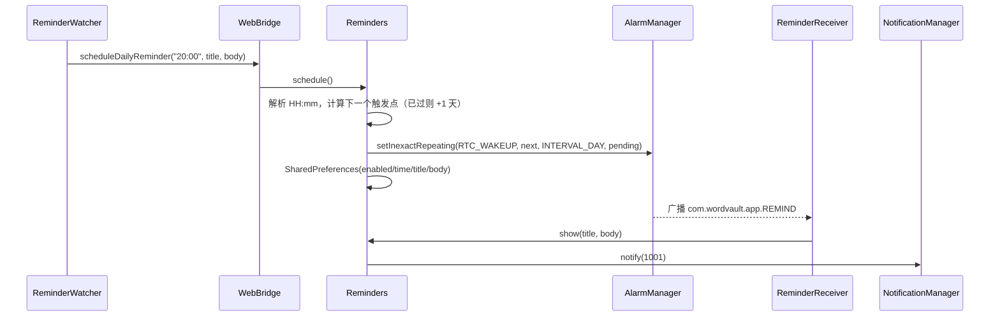

# 06 平台层与外围

## 1. Android 应用

Android 端不是 Capacitor/Cordova，而是一个**极简 WebView 外壳**：`android/` 下没有 Gradle 工程，直接用 SDK 命令行工具编译、打包、签名。前端产物是 `dist-single/index.html`（单文件、完全离线）。

### 1.1 目录结构

```text
android/
├── AndroidManifest.xml
├── build-apk.sh                 # 资源 -> javac -> d8 -> zip -> zipalign -> apksigner
├── build-native.sh              # 可选的 llama.cpp / JNI 交叉编译
├── res/                         # 图标、启动主题、字符串
├── src/com/wordvault/app/
│   ├── MainActivity.java        # WebView 宿主
│   ├── WebBridge.java           # window.WordVaultNative
│   ├── OnlineLlmBridge.java     # window.OnlineLlm
│   ├── Reminders.java           # 通知渠道 / 定时 / 恢复
│   ├── ReminderReceiver.java    # 每日提醒广播
│   ├── BootReceiver.java        # 开机 / 升级后恢复提醒
│   ├── ExportProvider.java      # 只读导出 ContentProvider
│   ├── LlmBridge.java           # 实验性本地模型桥
│   └── LlmEngine.java           # 实验性 JNI 封装
└── jni/
    ├── CMakeLists.txt
    └── llm_jni.cpp              # 实验性本地推理 JNI
```

### 1.2 Manifest 组件

| 组件 | 配置 | 作用 |
| --- | --- | --- |
| `MainActivity` | `exported=true`、`singleTask`、`configChanges` 覆盖旋转/屏幕尺寸/键盘/深浅色模式 | 唯一 Activity，加载 WebView |
| `ExportProvider` | `authorities=com.wordvault.app.exports`、`exported=false`、`grantUriPermissions=true` | 把备份文件以 `content://` 交给分享面板 |
| `ReminderReceiver` | 监听 `com.wordvault.app.REMIND` | 收到闹钟后发通知 |
| `BootReceiver` | 监听 `BOOT_COMPLETED` / `MY_PACKAGE_REPLACED` | 开机或升级后恢复每日提醒 |

权限只有三个：`INTERNET`、`POST_NOTIFICATIONS`、`RECEIVE_BOOT_COMPLETED`。**不申请存储权限**，导出走缓存目录 + ContentProvider。

`minSdk 24`、`targetSdk 34`、`versionCode/versionName` 由打包脚本覆盖。

### 1.3 MainActivity

`onCreate` 流程：

1. 代码创建 `WebView`，设置背景色、禁用过度滚动。
2. WebSettings：开启 JS、DOM Storage、Database、文件与 content 访问；关闭缩放；允许无手势媒体播放（保证发音）。
3. 注册三个 JS 接口：

| JS 对象 | Java 实现 | 说明 |
| --- | --- | --- |
| `window.WordVaultNative` | `WebBridge` | 通知、提醒、导出、平台信息 |
| `window.OnlineLlm` | `OnlineLlmBridge` | Kilo 在线模型原生 HTTP |
| `window.LlmNative` | `LlmBridge` | 实验性本地 GGUF（前端未接入） |

4. 自定义 `WebChromeClient`：
   - `onJsAlert` / `onJsConfirm` 用原生对话框展示（WebView 默认不显示 `alert`）。
   - `onShowFileChooser` 支持 `<input type="file">`，可接收单个或多个 Uri 结果。
5. `loadUrl("file:///android_asset/index.html")`。

其他生命周期：

| 回调 | 行为 |
| --- | --- |
| `onKeyDown(BACK)` | 可后退则 `webView.goBack()`，否则交给系统 |
| `onActivityResult` | 处理模型文件选择与通用文件选择，返回 `Uri[]` |
| `onRequestPermissionsResult` | 转交 `WebBridge` |
| `onResume` | 确保通知渠道存在，并向网页派发 `wordvault:permission-changed` |
| `onDestroy` | 依次销毁 LlmBridge / OnlineLlmBridge / WebBridge，移除并销毁 WebView |

### 1.4 WebBridge

`window.WordVaultNative` 暴露：

| 方法 | 返回 | 行为 |
| --- | --- | --- |
| `platform()` | `"android"` | 平台标识 |
| `notificationStatus()` | 字符串 | Android 13+ 检查 `POST_NOTIFICATIONS`，否则看 `areNotificationsEnabled()` |
| `requestNotificationPermission()` | — | Android 13+ 申请权限；低版本直接提示已开启 |
| `notifyNow(title, body)` | — | 立即发通知；无权限时引导授权 |
| `scheduleDailyReminder(hhmm, title, body)` | — | 设置每日重复闹钟 |
| `cancelDailyReminder()` | — | 取消闹钟并写入 prefs |
| `exportBackup(filename, content)` | — | 写 `cache/exports/*.json` 并调起系统分享 |

`exportBackup` 的细节：

- 文件名只保留 `[A-Za-z0-9._-]`，防止路径穿越。
- 内容加 UTF-8 BOM，方便 Windows 记事本正确识别中文。
- 通过 `ExportProvider.uriFor()` 生成 `content://com.wordvault.app.exports/<name>`，再 `ACTION_SEND` + `FLAG_GRANT_READ_URI_PERMISSION`。
- 无可用分享应用时提示文件位置。

权限结果会通过 `window.dispatchEvent(new Event('wordvault:permission-changed'))` 通知前端刷新状态。

### 1.5 每日提醒



- 通知渠道：`wordvault.reminder`（名称「每日学习提醒」，默认重要度，开启振动）。
- 闹钟类型：`setInexactRepeating`，**不申请精确闹钟权限**，允许系统省电对齐。
- 取消：`AlarmManager.cancel` + `enabled=false`。
- 恢复：`BootReceiver` 收到开机/升级广播后读取 prefs，若 `enabled=true` 则重新调度。

### 1.6 OnlineLlmBridge

**存在原因**：Kilo 网关的 CORS 策略会拦截浏览器 `fetch`。在 Android 中改用原生 `HttpURLConnection`，绕开 CORS，再把增量文本回传给网页。

| 项目 | 值 |
| --- | --- |
| 端点 | `https://ai-gateway.kilo.ai/api/v1/chat/completions` |
| 默认模型 | `kilo-auto/free` |
| 连接超时 | 15 秒 |
| 读取超时 | 90 秒 |
| 增量合并 | 70ms 刷新一次，主线程 `evaluateJavascript` |
| 最大 token | `max(maxTokens, 768)` |

**调用协议**：

```js
// 前端 -> 原生
window.OnlineLlm.generate(id, rolesJson, contentsJson, model, apiKey, maxTokens, temperature)

// 原生 -> 前端（模块加载时注册）
window.WordVaultOnline.onToken(id, text)
window.WordVaultOnline.onDone(id, ok, message)
```

**取消**：`cancel()` 置 `cancelled = true` 并 `disconnect()` 当前连接；前端收到 `onDone(id,false,"生成已停止")`。

**错误**：非 2xx 时读取错误流（最多 4096 字符），返回「在线 AI 返回 <code>：<detail>」。

### 1.7 实验性本地推理（未接入）

| 文件 | 作用 |
| --- | --- |
| `LlmBridge.java` | `window.LlmNative`：模型导入（SAF）、删除、加载、生成、取消；模型固定存放 `files/models/model.gguf` |
| `LlmEngine.java` | 加载 `libwordvault_llm.so`，声明 `nativeLoadModel / nativeGenerate / nativeFreeModel / nativeCancel / nativeSystemInfo` |
| `jni/llm_jni.cpp` | 基于 llama.cpp 的 JNI 实现 |
| `build-native.sh` | 拉取固定 commit 的 llama.cpp，用 NDK 27.2 交叉编译 `arm64-v8a` / `x86_64` |

前端 `src/` 中没有任何 `LlmNative` / `WordVaultLlm` 调用，`jniLibs` 也不在默认仓库中。该模块是未来「纯离线本地大模型」的预研代码，阅读主线时可以跳过。

### 1.8 APK 构建流水线

`android/build-apk.sh` 不依赖 Gradle：

```text
1. 校验 build-tools 34.0.0 与 platforms/android-34
2. cp dist-single/index.html -> build/assets/index.html
3. aapt2 compile res -> res.zip
4. aapt2 link -> base.apk（写入 assets、manifest、版本号）
5. javac -source 8 -target 8（classpath 只有 android.jar）
6. d8 -> classes.dex
7. zip 更新 base.apk，加入 classes.dex 与 lib/<abi>/*.so
8. zipalign -f -p 4
9. 首次生成 keystore，apksigner 签名并 verify
10. 输出 dist-android/WordVault.apk
```

可配置环境变量：

| 变量 | 默认 | 说明 |
| --- | --- | --- |
| `JAVA_HOME` | — | 建议 JDK 17 |
| `ANDROID_SDK_ROOT` / `ANDROID_HOME` | `/opt/android-sdk` | SDK 根目录 |
| `APK_NAME` | `WordVault.apk` | 输出文件名 |
| `APK_VERSION` / `APK_VERSION_CODE` | `1.0.0` / `1` | 版本 |
| `ABIS` | `arm64-v8a,x86_64` | 打包哪些原生库 |
| `WV_KEYSTORE_BASE64` | — | CI 注入固定 keystore，保证覆盖安装签名一致 |
| `KEYSTORE_PASSWORD` / `KEY_ALIAS` | `wordvault` | 签名参数 |

## 2. Windows

### 2.1 启动器 `windows/launcher.cs`

一个无控制台的 C# 程序，逻辑：

1. 定位同目录的 `index.html`，不存在则直接退出。
2. 依次尝试 Edge（Program Files x86 / Program Files）、Chrome（Program Files / x86 / LocalAppData）。
3. 找到后以应用模式启动：

```text
--app=file:///.../index.html --window-size=1200,900 --disable-features=Translate
```

4. 全部不存在时用系统默认浏览器打开 HTML。

### 2.2 安装包 `windows/installer.iss`

Inno Setup 脚本：

| 配置 | 值 |
| --- | --- |
| 安装目录 | `{autopf}\WordVault` |
| 输出 | `dist-windows/WordVault-Setup-<version>.exe` |
| 最低系统 | Windows 10，仅 x64 |
| 权限 | 默认最低权限，可提权 |
| 打包文件 | `dist-single/index.html`、`WordVault.exe`、`WordVault.ico` |
| 快捷方式 | 开始菜单 + 可选桌面快捷方式 |
| 安装后 | 可直接启动 |

### 2.3 构建步骤

```bat
npm run build:single
csc.exe /nologo /target:winexe /out:windows\WordVault.exe /win32icon:windows\WordVault.ico windows\launcher.cs
ISCC.exe /DMyAppVersion=1.0.0 windows\installer.iss
```

## 3. Serverless 代理 `serverless/kilo-proxy.js`

Cloudflare Worker，用于在浏览器环境下访问不支持 CORS 的 Kilo 网关。

| 行为 | 说明 |
| --- | --- |
| 上游 | `https://ai-gateway.kilo.ai/api/v1` |
| 允许方法 | `POST`、`OPTIONS`（预检返回 204） |
| CORS | `*`，允许任意头，预检缓存 1 天 |
| 转发 | 原样转发 `pathname + search`、请求头与流式 body |
| 清理 | 删除 `host / origin / referer / cf-connecting-ip`，删除响应的 `content-encoding / content-length` |
| 流式 | 直接返回 `upstream.body`，不缓冲 SSE |

使用方式：部署 Worker 后，在「我的 → AI 引擎」把提供方地址填成 Worker 域名，前端会请求 `<域名>/chat/completions`。

## 4. Service Worker `public/sw.js`

| 阶段 | 行为 |
| --- | --- |
| install | 预缓存 `./`、`./data/index.json`、`./favicon.svg`，`skipWaiting` |
| activate | 删除旧版本缓存（当前 `wordvault-v3`），`clients.claim` |
| fetch | 仅处理同源 GET |

策略：

- **页面导航**：network-first，成功后回写 `./`；离线回退缓存的入口页。
- **静态资源 / 词库**：cache-first，未命中则请求并写入缓存。
- 完整词库 `dictionary.json` 首次访问后进入缓存。

单文件构建不会注册 Service Worker（`VITE_SINGLE_FILE` 分支），因为所有资源已内联。

## 5. GitHub Actions

### 5.1 `deploy.yml`

- 触发：push `main` 或手动。
- Node 22，`npm ci`，`PAGES_BASE=./ npm run build`。
- 上传 `dist` 到 GitHub Pages 并部署。
- `base=./` 让资源使用相对路径，兼容仓库子路径。

### 5.2 `release.yml`

- 触发：推送 `v*` 标签或手动输入版本号。
- `prepare`：统一解析版本（去掉前缀 `v`）。
- `apk`：JDK 17 + Android SDK 34 + build-tools 34，构建单文件与 APK，注入 `WV_KEYSTORE_BASE64`、`KEYSTORE_PASSWORD`。
- `windows`：Windows Runner，`choco install innosetup`，`csc.exe` 编译启动器，`ISCC.exe` 生成安装包。
- `release`：收集三个产物并创建 GitHub Release：
  - `WordVault-<version>.apk`
  - `WordVault-Setup-<version>.exe`
  - `WordVault-<version>-single.html`

## 6. 安全与隐私设计

| 面 | 措施 |
| --- | --- |
| WebView | 只加载本地 `file://` 资源，不启用 `setAllowUniversalAccessFromFileURLs` |
| 原生桥 | `@JavascriptInterface` 只暴露必要方法；导出文件名做字符白名单 |
| 文件导出 | 只读 ContentProvider，路径限定 `cache/exports`，拒绝含 `/`、`\` 的文件名 |
| 通知 | 先检查权限，`SecurityException` 静默处理 |
| 网络 | 仅 AI 请求出网；无统计、无上报 |
| AI Key | 仅本地 localStorage；代理 Worker 不记录请求 |
| 备份 | 明文 JSON，导出文件由用户自行保管 |

## 7. 平台能力矩阵

| 能力 | 浏览器 | 单文件 HTML | Android | Windows |
| --- | --- | --- | --- | --- |
| 离线词库 | 需先联网缓存 | 完全内联 | 完全内联 | 完全内联 |
| 系统通知 | Notification API | 受限 | 原生通知 | 浏览器窗口内 |
| 每日提醒 | 页面打开时轮询 | 同左 | AlarmManager | 同左 |
| 导出备份 | `<a download>` | 受限 | 系统分享面板 | `<a download>` |
| 自定义字体 | IndexedDB + FontFace | 同左 | 同左 | 同左 |
| 在线 AI | fetch | fetch | 原生 HTTP（Kilo） | fetch |
| 本地 GGUF | — | — | 实验性，未接入 | — |
| 自动更新 | Service Worker | 手动替换文件 | 重装 APK | 重装安装包 |
